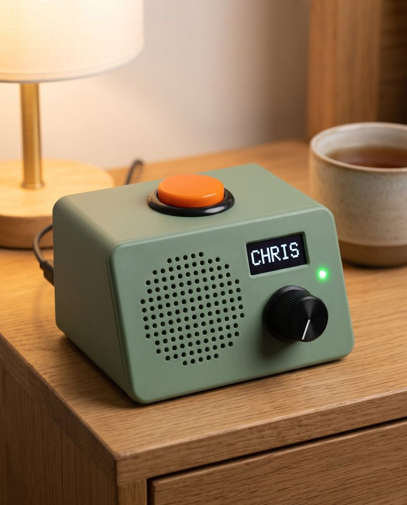
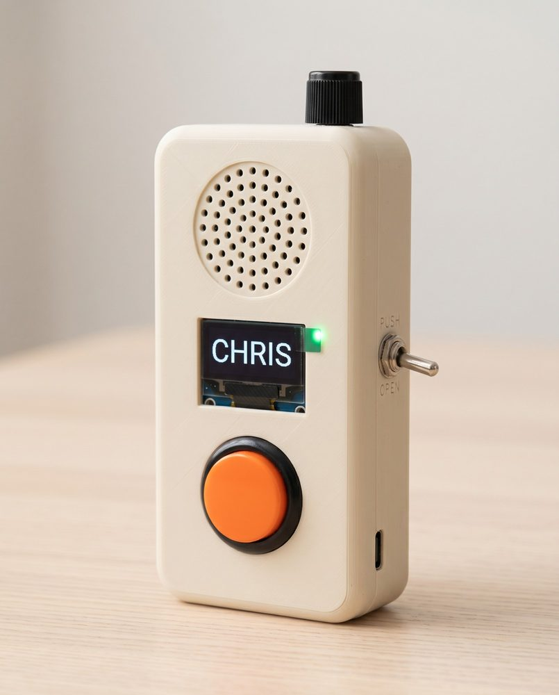
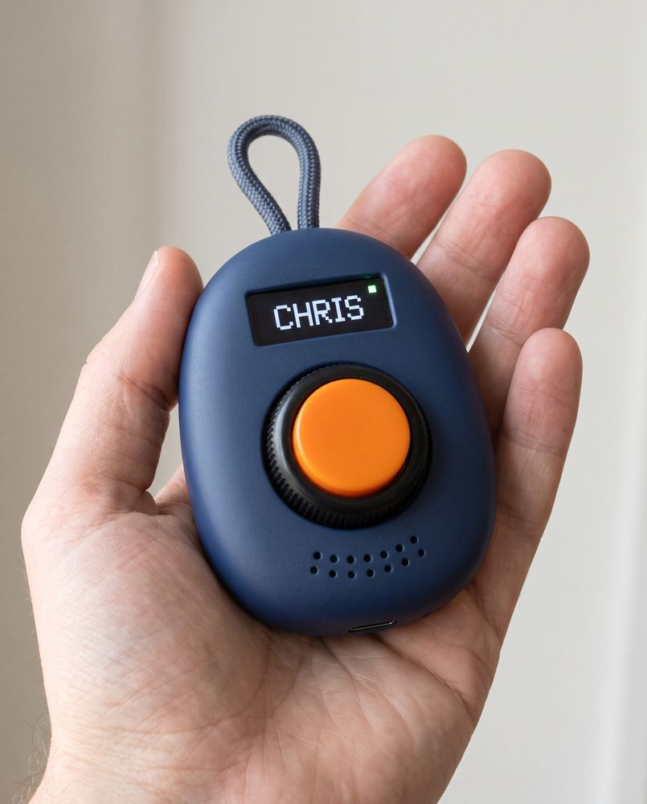
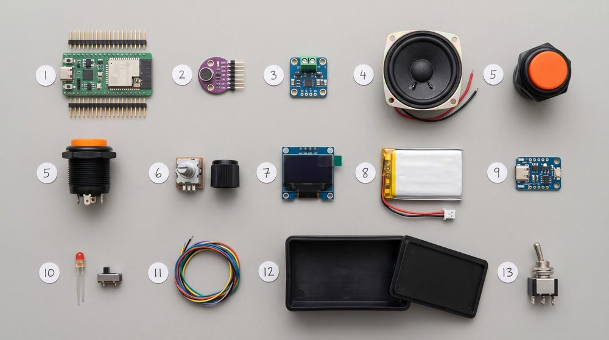

# Grandad's radio

A walkie-talkie with one big button, made for Grandad.

Mobile phones can be tricky for older people. Small icons, passcodes, updates and menus get in the way when all they want is an easy way to reach the people they love. This project is a small radio that does one thing: hold the orange button to talk, let go to listen. It works over Wi-Fi, so the family can be in the next room or the next town.

**See it and try it:** https://cgbarlow.github.io/walkie-talkie/



*Concept picture. The first unit is still being designed.*

| Classic handheld | Pocket pebble | The parts |
| --- | --- | --- |
|  |  |  |

## Where it's at

This is a family project at the research and design stage. Nothing is built yet.

| Stage | What | Status |
| --- | --- | --- |
| 1 | Prove the idea on two Rabbit R1s, reflashed to run one app | Now |
| 2 | Build our own radio on an ESP32, for about NZ$35 to 50 in parts | Next |

Both stages use the same small relay server and the same sounds, so an R1 and an ESP32 unit can share a channel.

### Making the R1 work count

The R1 is a temporary client. Most of what Stage 1 builds is used again in Stage 2:

- **Used again as is:** the relay server, the control page, the protocol, the sounds and screen states, and everything learned from the week with Grandad.
- **Written once for both:** a small C library holding the protocol, encryption, jitter buffer and turn-taking. The R1 app calls it; the ESP32 firmware compiles the same files.
- **Built first:** a written protocol spec and a laptop test client, so the server can be tested without either device and the two devices can be checked against each other.
- **R1 only, kept small:** reflashing, the button remap and locking the R1 to one app.

Afterwards the R1s can stay on the same channels as the ESP32 radios. The detail is in the [R1 doc](Rabbit%20R1%20Walkie-Talkie%20Research%20and%20Design.md#making-the-r1-work-count-for-stage-2).

## How it works

- **Hold to talk.** One talker at a time, like a real radio. A chirp says it's ready, a roger beep says the message ended.
- **A knob picks who.** Each click says the name out loud. A channel can be one person or a group, such as the whole family.
- **PUSH / OPEN switch.** Flip to OPEN to talk hands-free, taking turns. It works on group channels too, and the radio says out loud who can hear. The red light stays on whenever the microphone can hear. This part is a design proposal and hasn't been tested.
- **Private.** Messages are encrypted on the radio. The server passes them on but can't open them, and nobody can switch the microphone on from somewhere else.
- **Looks after itself.** It keeps the last message for 24 hours and tells the family if it goes offline or the battery runs low.

It is not an emergency alarm. In an emergency, call 111.

## What's in this repo

| File | What it is |
| --- | --- |
| [`index.html`](index.html) | The project site, in one file. Includes a simulator you can try in the browser |
| [Rabbit R1 Walkie-Talkie Research and Design](Rabbit%20R1%20Walkie-Talkie%20Research%20and%20Design.md) | Stage 1: the R1 hardware, reflashing, the app, networking, and designing for Grandad |
| [Walkie-Talkie Beyond the R1: Minimum Hardware](Walkie-Talkie%20Beyond%20the%20R1%20Minimum%20Hardware.md) | Stage 2: the ESP32 build, parts and NZ prices, pairing, power, and open channel mode |
| [Walkie-Talkie Image Prompts](Walkie-Talkie%20Image%20Prompts.md) | The prompts used to make the concept pictures |
| [`images/`](images) | Concept pictures. These are generated images, not photos of real units |

## Running the site locally

The site is one HTML file with no build step. Open `index.html` in a browser, or serve the folder:

```bash
python3 -m http.server 8000
```

Then go to http://localhost:8000.

To update the progress shown on the site, change the `done` numbers in the `PLAN` object near the bottom of `index.html`.

## Licence

Free for non-commercial use. Build one for your own family, change it, share it.

- **Code** (including `index.html`): [PolyForm Noncommercial 1.0.0](LICENSE)
- **Research documents and images:** [CC BY-NC-SA 4.0](https://creativecommons.org/licenses/by-nc-sa/4.0/). Credit Chris Barlow, don't use them commercially, and share any changed versions under the same licence.

Building or selling radios commercially needs a licence. See [COMMERCIAL.md](COMMERCIAL.md).
