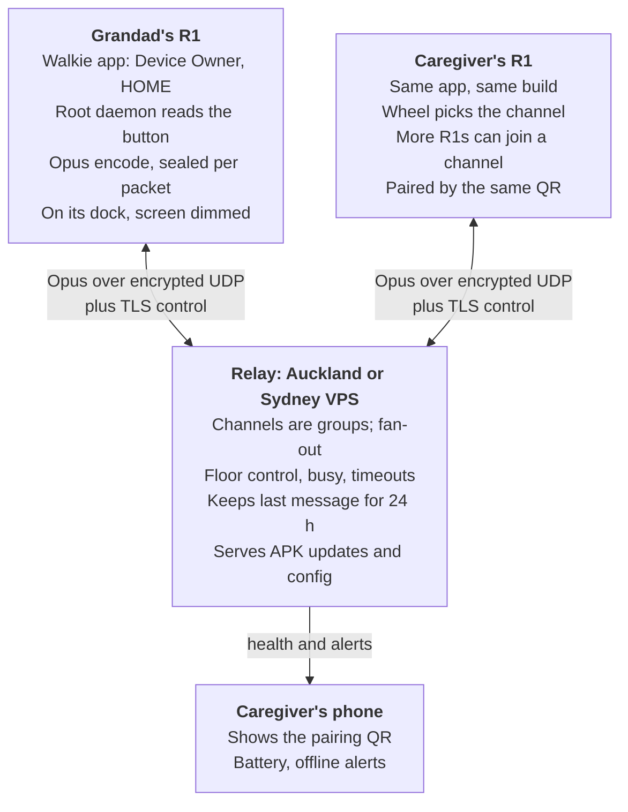

# Rabbit R1 Walkie-Talkie: Research and Design

Nov 8, 2026 · @Chris Barlow

## Summary

**Yes, this is very doable, and the R1 is a good fit.** It is an Android 13 handset with a hardware talk button, a wheel, a 2 W speaker and Wi-Fi plus LTE, and its MediaTek chip has an unpatchable boot exploit, so you can always get in and almost never brick it.

The recommended build:

- **Reflash** both R1s to the LineageOS 21 GSI and root them. Stock rabbitOS cannot run your own app.
- **Remap the side button**, which Android treats as power, with a root key layout override. The wheel already arrives as volume keys.
- **One app as Device Owner and HOME** in lock task mode. It boots into the walkie, cannot be escaped, and updates itself from your server.
- **Opus over encrypted UDP** to a small relay in Auckland or Sydney, with a TLS control channel for floor control and pairing. Do not go peer-to-peer: carrier NAT on LTE breaks it.
- **QR pairing** carries the relay address and a group key. Channels are server-side groups; broadcast is free.
- **Expected latency** about 70 to 130 ms on Wi-Fi, 150 to 250 ms on LTE. That beats real trunked radio.

Three things to know before you start: the R1 lacks NZ's 700 MHz LTE band (fine in town on Band 3, weak rurally), Rabbit has stopped making R1s, and this is a convenience link, not a medical alarm.

Fastest path: a Zello smoke test on the flashed devices in an evening, then a custom app and relay over a few weekends.

## The R1 hardware

The R1 is a small Android 13 phone with no phone app, which is good news: everything a walkie-talkie needs is already there. Two catches: the side button is wired as the power key, and the LTE radio lacks NZ's 700 MHz band.

| Part         | Spec                                                                                           | What it means here                                                 |
|--------------|------------------------------------------------------------------------------------------------|--------------------------------------------------------------------|
| SoC          | MediaTek MT6765 (Helio P35), 4 GB RAM, 128 GB                                                  | Plenty for Opus and a tiny app                                     |
| OS           | rabbitOS on AOSP Android 13                                                                    | Reflashable to Android 14 GSIs                                     |
| Audio        | 2 W speaker, two far-field mics                                                                | Loud enough on paper; no measured SPL found                        |
| Side button  | The only physical button; Linux reports it as KEY_POWER                                        | Needs root to become a PTT key                                     |
| Scroll wheel | Separate input device; ROMs map it to volume up/down                                           | Apps can read it without root                                      |
| Screen       | 2.88 inch TFT touch                                                                            | Room for one big word and a name                                   |
| Wi-Fi / BT   | 2.4 GHz only, BT 5.0                                                                           | Check the home router has 2.4 GHz on                               |
| LTE          | Nano-SIM, data only. Bands 1, 2, 3, 4, 5, 7, 8, 12, 17, 20, 25, 26, 34, 38, 39, 40, 41, 66, 71 | No Band 28 (700 MHz). B3 covers NZ cities; rural and indoor weaker |
| Battery      | 1000 mAh (3.45 Wh). 36+ h screen-off standby, about 2.5 h heavy use                            | Plan for a dock and daily charge                                   |

Sources: [iFixit](https://www.ifixit.com/Device/Rabbit_R1), [Android Authority](https://www.androidauthority.com/rabbit-r1-android-13-3438954/), [Rabbit SIM bands](https://www.rabbit.tech/support/article/rabbit-working-sim-cards), [Rabbit battery](https://www.rabbit.tech/support/article/rabbit-r1-battery-life), [frogmoses/rabbit-r1](https://github.com/frogmoses/rabbit-r1).

**NZ mobile.** Rabbit lists only 2degrees as tested in NZ. Spark and One NZ share Band 3 and 7, so they should work in town. 2G and 3G closed by end of 2025, but a data-only PTT app does not care. Home Wi-Fi is the primary link; LTE is the backup.

**Company risk.** Rabbit stopped making the R1 by September 2026, has about 15 staff and pivoted to OS3, a cloud agent ([The Outpost](https://theoutpost.ai/news-story/rabbit-pivots-from-r1-hardware-to-launch-os-3-cross-platform-ai-agent-31212/), [Tom's Guide](https://www.tomsguide.com/ai/whats-next-for-rabbit-employees-say-they-havent-been-paid-for-months-while-company-teases-new-ai-hardware)). No end-of-life date is announced. A reflash that removes every Rabbit cloud dependency is the safe bet, and it means a third or fourth R1 off Trade Me works too.

## Getting control of the R1

The R1 is about as open as hardware gets: you can always get in, and it is very hard to brick. Stock rabbitOS has no supported way to sideload an APK, so in practice "run my own app" means "reflash".

**Why it is open.** The MT6765 has an unpatchable BootROM bug (kamakiri) and the R1 ships without MediaTek's newer auth checks, so [mtkclient](https://github.com/frogmoses/rabbit-r1) reads and writes any partition over USB ([Hackster](https://www.hackster.io/news/going-down-a-rabbit-hole-to-jailbreak-the-r1-e58a0c483c99)). Since March 2025 Rabbit also offers an official, warranty-voiding developer unlock ([Rabbit blog](https://www.rabbit.tech/blog/making-r1-more-accessible-to-the-developer-community), [support article](https://www.rabbit.tech/support/article/unlock-bootloader-rabbit-r1)). One July 2026 report says the official toggle never reached the device, so he flipped the unlock byte with mtkclient instead ([Doug Belshaw](https://substrate.dougbelshaw.com/rabbit-r1-android)).

**ROM options.**

| Build                                                                              | Android | Status (Nov 2026)     | Notes                                                                                                       |
|------------------------------------------------------------------------------------|---------|-----------------------|-------------------------------------------------------------------------------------------------------------|
| [LineageOS 21 GSI](https://substrate.dougbelshaw.com/rabbit-r1-android) (Andy Yan) | 14      | Builds into mid-2026  | Most current. Play Store works. Recommended                                                                 |
| [CipherOS device tree](https://gitea.com/techyminati/device_rabbit_r1/src/)        | 14/16   | Last commit June 2025 | Proper device tree with audio HAL; [frogmoses](https://github.com/frogmoses/rabbit-r1) adds root boot fixes |
| [R1 Escape](https://github.com/RabbitHoleEscapeR1/r1_escape)                       | 13 AOSP | 2024, dormant         | Scripts still useful for the unlock steps                                                                   |
| [rabbitude](https://github.com/rabbitude)                                          | n/a     | No public repos       | Ignore                                                                                                      |

**Known rough edges.** Touch can die after suspend (frogmoses works around it by never letting the screen suspend), the default launcher crashes (irrelevant, we replace it), auto-rotate is broken, and the standard fastboot CLI can hang ([veritas06 guide](https://gist.github.com/veritas06/462844437bd8c5751b85d99c78c68fd8), [frogmoses](https://github.com/frogmoses/rabbit-r1)).

**The PTT button problem.** Android treats the side button as KEYCODE_POWER and never passes it to apps. With root you either remap scancode 116 in the key layout file, or run a small root daemon that grabs the evdev device and forwards press and release to the app, as frogmoses already does. You then reimplement power (long hold to shut down). The wheel arrives as volume keys, which any foreground app can read.

**Unlock and flash, in order.**

1.  Use a Linux x86_64 host (Windows needs MediaTek VCOM drivers; Apple Silicon needs mainline mtkclient).
2.  Back up each device first: `mtk rl --skip userdata`, plus nvram so the IMEI and Wi-Fi calibration survive. Label which backup is which unit.
3.  Unlock (official dev mode, or set the frp unlock byte with mtkclient), then `fastboot flashing unlock`.
4.  Flash vbmeta with verity off, then the LineageOS GSI from fastbootd, then `fastboot -w`.
5.  Root with Magisk (patched boot image) for the button daemon.
6.  Run `adb shell getevent -lt` and press everything. Write down the real scancodes.

**Way back.** Rabbit publishes [stock firmware](https://github.com/rabbit-hmi-oss/firmware) and a [browser flash tool](https://rabbit-hmi-oss.github.io/flashing). With mtkclient able to rewrite anything, a permanent brick is unlikely; losing un-backed-up nvram is the real risk.

**No-reflash alternative: Creations.** Rabbit's web-app SDK does expose the side button (longPressStart, longPressEnd) and wheel (scrollUp, scrollDown) ([SDK reference](https://github.com/rabbit-hmi-oss/creations-sdk/blob/main/plugin-demo/reference/creation-triggers.md)). But mic access is undocumented, nobody has shown live audio working, and it still runs inside rabbitOS and depends on Rabbit's servers. Fine for a weekend experiment, wrong for Grandad.

## Kiosk mode and the controls

Make the walkie-talkie app the device's owner and its home screen. Then the R1 boots into it, cannot leave it, and the app can update itself. No MDM, no Google account.

**Lock it down (Android's dedicated-device APIs).**

1.  Fresh flash, no accounts, no extra users. Then `adb shell dpm set-device-owner <pkg>/.AdminReceiver` ([Android cookbook](https://developer.android.com/work/dpc/dedicated-devices/cookbook)).
2.  In the app: `setLockTaskPackages` for itself, `lockTaskMode="if_whitelisted"` on the activity, and `addPersistentPreferredActivity` so it is HOME. Lock task hides status bar, home, recents and the lock screen ([lock task mode](https://developer.android.com/work/dpc/dedicated-devices/lock-task-mode)).
3.  `setLockTaskFeatures` with only `GLOBAL_ACTIONS`, so a long hold can still power off.
4.  User restrictions: no safe boot, no factory reset, no system error dialogs. Do not set `DISALLOW_ADJUST_VOLUME`; it mutes the device.

Screen pinning is not a kiosk; anyone can exit it. [OwnDroid](https://github.com/BinTianqi/OwnDroid) (GPL) is a handy manual DPC for testing these settings. [Headwind MDM](https://github.com/h-mdm/hmdm-server) is a self-hosted fallback, but its kiosk mode is paid.

**Staying alive.**

- Being HOME launches the app at boot; no boot receiver needed.
- Start the microphone foreground service from the visible activity. Since Android 14 a boot receiver cannot start one, but Device Owner apps are exempt from the background-start and while-in-use rules ([Android FGS restrictions](https://developer.android.com/develop/background-work/services/fgs/restrictions-bg-start)).
- It lives on a dock, so keep the screen on (dimmed) while plugged in. That sidesteps Doze, keeps Wi-Fi in low-latency mode (which needs screen on and foreground since API 34) and avoids the R1's touch-dies-after-suspend bug ([WifiManager](https://developer.android.com/reference/android/net/wifi/WifiManager), [frogmoses](https://github.com/frogmoses/rabbit-r1)). Exempt the app from battery optimisation for time off the dock.

**The side button.** Android sees it as power, which apps never receive. With root, drop a key layout override at `/data/system/devices/keylayout/<device>.kl` mapping scancode 116 to a spare code such as `F13`, `MACRO_1` or `PROG_RED`, on the PTT input device only ([key layout files](https://source.android.com/docs/core/interaction/input/key-layout-files)). The alternative is a root daemon that grabs the evdev node, as frogmoses does, which also works with the screen off. Then reimplement power as a long hold.

**The wheel.** Reported as volume up/down, which a foreground app reads directly; if it turns out to be a rotary device it arrives as scroll events ([rotary input](https://developer.android.com/training/wearables/user-input/rotary-input)). Consume the keys so they never change system volume; the app sets volume itself.

**First hour on the bench.** Run `getevent -lp` then `getevent -lt` and press and roll everything ([getevent](https://source.android.com/docs/core/interaction/input/getevent)). No public source lists the R1's real scancodes.

**Audio.** Capture with `VOICE_COMMUNICATION` (it wins capture priority), play in `MODE_IN_COMMUNICATION` routed with `setCommunicationDevice(BUILTIN_SPEAKER)`, and pin volume at max in code ([AudioManager](https://developer.android.com/reference/android/media/AudioManager)).

**Remote care.** As Device Owner the app can install its own updates silently via `PackageInstaller`: poll a manifest on your server, download, install. No Play Store. The same channel carries config (volume, quiet hours, wheel lock) and health pings back. Avoid leaving ADB over Wi-Fi open on Grandad's network.

## Audio and networking

Your UDP instinct is right, with one addition: a reliable control channel beside it. Every serious PTT system works this way. Expect about 70 to 130 ms mouth-to-ear on Wi-Fi and 150 to 250 ms on LTE, provided the relay sits in NZ or Sydney.

**Transport.** Mumble sends voice as UDP, one Opus frame per packet, with TLS over TCP for control, and tunnels voice over TCP only when UDP is blocked ([Mumble protocol](https://mumble-protocol.readthedocs.io/en/latest/voice_data.html)). Zello defaults to UDP and warns that TCP-only adds delay ([Zello](https://support.zello.com/zc/advanced-settings)). TCP's problem is head-of-line blocking: one lost packet stalls everything behind it for at least a round trip. With UDP the same loss costs one 20 ms frame that Opus hides. Use:

- TLS (or WebSocket on 443) for control: join, floor requests, presence, heartbeat.
- Encrypted UDP for voice, same server.
- Automatic fallback to voice-over-TLS when UDP fails (some guest Wi-Fi blocks it).
- QUIC datagrams ([RFC 9221](https://www.rfc-editor.org/rfc/rfc9221)) are a tidy v2. Full WebRTC is more machinery than two walkie-talkies need.

**Codec.** Opus, mono, 20 ms frames, 16 to 24 kbit/s VBR, VOIP mode, in-band FEC on with a 10% loss hint, DTX off ([RFC 6716](https://www.rfc-editor.org/rfc/rfc6716), [Xiph](https://wiki.xiph.org/Opus_Recommended_Settings)). Lean to 24 kbit/s: the extra high-frequency detail helps older ears. Bundle libopus 1.5 via JNI rather than Android's MediaCodec; you get FEC control and Deep PLC on both ends ([Opus 1.5](https://opus-codec.org/demo/opus-1.5/)).

**Latency budget (one way, ms).**

| Stage                            | Wi-Fi       | LTE          |
|----------------------------------|-------------|--------------|
| Capture (Oboe, low-latency mode) | 10-20       | 10-20        |
| Fill one 20 ms frame + encode    | 25-27       | 25-27        |
| Up to relay                      | 2-10        | 20-40        |
| Down to listener                 | 2-10        | 20-40        |
| Jitter buffer                    | 20-40       | 60-100       |
| Decode + playback                | 10-25       | 10-25        |
| **Total**                        | **~70-130** | **~150-250** |

For scale: the 3GPP mission-critical PTT target is under 300 ms mouth-to-ear ([TS 22.179](https://www.itecspec.com/3gpp/22.179/s/6.15.3.2)), and NIST measured trunked land mobile radio at 403 to 417 ms ([NIST IR 8206](https://nvlpubs.nist.gov/nistpubs/ir/2018/NIST.IR.8206.pdf)). So this beats a real radio system. Android audio is the wild card: OboeTester showed 20 ms round trip with low-latency mode and 205 ms without it ([Android](https://developer.android.com/games/sdk/oboe/low-latency-audio)). Measure the R1 with OboeTester before promising anything. A US relay adds 130 to 160 ms; keep the server close.

**NAT: do not go peer-to-peer.** Over 90% of cellular networks use carrier-grade NAT, and about 40% of those are symmetric ([Richter et al.](https://arxiv.org/pdf/1605.05606)). Two hard NATs means hole punching basically never works ([Tailscale](https://tailscale.com/blog/how-nat-traversal-works)). Both devices should dial out to one relay with a public IP. Identify each device by a session token in the packet, not by IP and port, so it survives a hop from Wi-Fi to LTE.

**Where the relay lives.**

- **Small Auckland or Sydney VPS.** Recommended. Public UDP, data-centre power, roughly NZ$5 to 15 a month.
- **Home Mac Mini.** Works only with a public IP and a UDP port forward. Cloudflare Tunnel does not publish raw UDP to arbitrary clients ([Cloudflare](https://developers.cloudflare.com/cloudflare-one/networks/connectors/cloudflare-tunnel/routing-to-tunnel/protocols/)), so it can carry the TLS fallback but not the voice path. Also a single point of failure on a power cut.
- **Tailscale.** Adds a VPN login on Grandad's device and relays via Sydney when direct fails. Not worth it.

**Data and battery.** Headers dominate at 20 ms framing: 24 kbit/s Opus is about 46 kbit/s on the wire, roughly 21 MB per hour of talk. Twenty minutes a day is about 200 MB a month. Cellular NAT mappings expire in a median 65 s ([Richter et al.](https://arxiv.org/pdf/1605.05606)), so send a UDP keepalive every 25 to 50 s. Bytes are trivial (about 0.4 MB a day); the cost is the LTE radio waking each time. On the dock over Wi-Fi it does not matter.

## Pairing and channels

A QR code works well for pairing, and "channels" map neatly onto server-side talk groups with one talker at a time. The relay forwards encrypted packets it cannot read.

**What the QR holds.** About 150 bytes, which fits a small QR:

```
ptt://v1?h=relay.example.nz&p=64738&g=<group id>&k=<32-byte group key>&s=<server cert pin>
```

No names or phone numbers. Treat the QR like a password: show it only on the caregiver's phone, scan it with the R1's camera during setup, then forget it. A later QR can add more channels.

**Encryption.** Each voice packet is sealed with ChaCha20-Poly1305 using the group key and a counter nonce (sender, spurt, frame). The routing header (group, sender, sequence) is authenticated but readable, so the relay routes without decrypting ([libsodium](https://doc.libsodium.org/secret-key_cryptography/aead/chacha20-poly1305/xchacha20-poly1305_construction)). Control traffic runs over TLS with the pinned certificate. This is Mumble's TLS-plus-per-packet-AEAD split ([Mumble](https://mumble-protocol.readthedocs.io/en/latest/establishing_connection.html)), but end to end rather than hop by hop. A lost device can listen until you rotate the key, so give the caregiver a "reset group" button that issues a new QR.

**Channel model.**

- Each channel is a group on the relay. Turning the wheel leaves one group and joins the next.
- The relay fans each packet out unchanged to every other member. Broadcast falls out for free; 2 to 10 members is trivial load.
- Floor control: `FLOOR_REQUEST` gets `GRANTED` or `DENIED {who}`. The relay drops voice from anyone not holding the floor, ends a turn after 1.5 s of silence or 60 s total, and broadcasts who is talking.
- Capture starts the instant the button goes down (pre-roll), so the first word survives a slow grant; if denied, discard it and play the busy tone. 3GPP targets floor grant within 300 ms ([TS 22.179](https://www.itecspec.com/3gpp/22.179/s/6.15.3.2)).
- The relay keeps the last spurt per channel for 24 hours so a device that was asleep or offline can play the missed message.
- Optional caregiver priority: the caregiver can pre-empt the floor.

**Multicast** only works on one LAN. Useful as a fast path when both units share the house Wi-Fi; never the primary route.

## Existing software

Nobody has published an R1 walkie-talkie yet; the only trace is a 2024 forum request for one ([rabbit community](https://forum.rabbitcommunity.tech/t/will-the-r1-receive-calls/11501)). So you would be first. The building blocks exist, though.

| Option                                                                                       | Licence     | What you get                                                          | Catch                                                                      |
|----------------------------------------------------------------------------------------------|-------------|-----------------------------------------------------------------------|----------------------------------------------------------------------------|
| [Mumla](https://f-droid.org/repository/browse/?fdid=se.lublin.mumla) (Android Mumble client) | GPLv3       | v3.7.3, Mar 2026. Opus, configurable hardware PTT key, hold or toggle | Maintainer wants a successor. Key only works in foreground (fine in kiosk) |
| [Mumble server](https://www.mumble.info/downloads/)                                          | BSD         | 1.5.939, Oct 2026. Docker image, port 64738. Channels built in        | Server decrypts voice hop by hop                                           |
| [Zello](https://support.zello.com/zc/screen-button-for-ptt-android) free                     | Proprietary | Hardware PTT, message replay, works through NAT                       | Screen must be on, Zello's cloud, no kiosk lock                            |
| [Zello Work](https://support.zello.com/zw/management-console-settings-for-android-devices)   | Proprietary | Auto-start, forced PTT key, auto-join channels                        | About US$163 to 192 a year for two users                                  |
| [OpenPTT](https://github.com/sudo-py-dev/OpenPTT)                                            | MIT         | Rust relay, Opus over UDP, floor control, Kotlin client               | 3 commits; a reference, not a base                                         |
| [VoicePing SDK](https://github.com/SmartWalkieOrg/VoicePing-Walkie-Talkie-AndroidSDK)        | MIT         | Group PTT, Opus over WebSocket, self-hostable router                  | TCP, so head-of-line blocking on LTE                                       |
| [GoSpeak](https://pkg.go.dev/github.com/NicolasHaas/gospeak)                                 | AGPL        | Go SFU, Opus over UDP, AES-GCM                                        | Not PTT; licence awkward                                                   |

**Three ways to build it** (effort is my estimate; all assume both R1s are already flashed and the button is mapped):

- **Zello**: hours. Proves the hardware works. Not the final answer: cloud dependency and UI not sized for 2.88 inches.
- **Mumla fork plus Mumble server**: about 3 to 7 days. Hard-code the server, force PTT, replace the UI with one full-screen state view, wire the wheel to channel joins. Mature protocol, self-hosted, GPL is fine for a family build.
- **Custom app plus custom relay**: about 2 to 4 weeks. Exact UX, end-to-end encryption, missed-message replay, permissive licence. You own every audio and network edge case.

Forking Mumla makes the client GPLv3. That only matters if this ever becomes a product; then start from the MIT pieces.

## Designing for Grandad

The device should do one thing, sound and look the same forever, and tell the caregiver when something is wrong. Familiar radio metaphor, no menus, adult styling ([SCUF principles](https://wrexham.repository.guildhe.ac.uk/id/eprint/219/), [INDUCT guidance](https://www.dementiainduct.eu/guidance/themes/digital-applications/)).

**Hearing.** Age-related loss takes the 2 to 4 kHz band first, where s, f, th and sh live ([HyperPhysics](https://hyperphysics.gsu.edu/hbase/sound/audiom.html), [EarPros](https://www.earpros.com/au/blog/speech-banana)). About 1 in 3 people aged 65 to 74 have hearing loss ([NIDCD](https://www.nidcd.nih.gov/health/age-related-hearing-loss)). So: boost received speech around 6 to 10 dB in 2 to 4 kHz, compress and limit, ship near max volume. Do not make the voice sound "radio-like". Save the static for the chirp.

**Sounds and screen states.**

| State                      | Sound                                | Screen                  |
|----------------------------|--------------------------------------|-------------------------|
| Button pressed, link ready | Squelch chirp within 300 ms          | Red, TALKING            |
| Button pressed, no link    | Low double buzz                      | Amber, NOT CONNECTED    |
| Someone else talking       | Busy tone, no transmit               | Amber, WAIT             |
| Incoming voice             | Short kerchunk, then speech          | Green, LISTENING + name |
| End of message             | Roger beep + squelch tail            | Grey, READY             |
| Battery under 30%          | Spoken "Please put me on my charger" | Flashing CHARGE ME      |

The 300 ms figure is the 3GPP target for floor grant after a PTT press; real systems buffer from press time so the first word is never clipped ([US 11197131](https://patents.google.com/patent/US11197131)). All sounds can be synthesised from band-passed white noise and short tones, so no licensing ([windytan](https://www.windytan.com/2019/03/beeps-and-melodies-in-two-way-radio.html)).

**Controls.**

- The R1 side button is small and hold-to-talk needs sustained pressure. Offer a caregiver setting for tap-to-start, tap-to-stop with a timeout.
- The scroll wheel is the biggest accidental-change risk. Speak each step aloud ("Channel two, Chris"), snap back after a few seconds unless confirmed, or lock it remotely. With one or two contacts, disable it.
- Double-press to replay the last message.

**Reliability.** Rabbit quotes over 36 hours screen-off standby but only about 2.5 hours of heavy audio ([Rabbit support](https://www.rabbit.tech/support/article/rabbit-r1-battery-life)). Live on a dock. Heartbeat every few minutes; alert the caregiver on offline or low battery, which the [Dementia Friendly Technology Charter](https://www.wwl.nhs.uk/media/Services/Dementia/Dementia_Friendly_Technology_Charter.pdf) explicitly asks for. Zello recovers up to 50 missed messages per channel from 24 hours but does not auto-play them ([Zello](https://support.zello.com/zw/message-recovery)); for Grandad, auto-play once with "You have a message from Chris".

**Privacy and consent.** Mic live only while the button is held, never a remote listen-in. Red screen doubles as the mic indicator. Get his consent and revisit it. NZ's domestic-affairs privacy exemption does not cover anything "highly offensive to an ordinary reasonable person" ([Privacy Commissioner](https://privacy.org.nz/blog/to-film-or-not-to-film)).

**Not an alarm.** Print a card: "This is not an emergency alarm. Call 111." No button labelled Help or SOS. If he is frail or lives alone, pair this with an accredited monitored alarm; Work and Income funds rental via the Disability Allowance, in-home from $16.22 a week, fall detectors excluded ([Work and Income](https://www.workandincome.govt.nz/eligibility/health-and-disability/medical-alarms)).

**When a $80 UHF CB pair wins.** If you are both within a kilometre or two, licence-free PRS radios ([RSM](https://rsm.govt.nz/licensing/frequencies-for-anyone/citizen-band-radio-gurl)) give near-zero latency, no server and days of battery. They lose on privacy (shared channels), hilly terrain, distance, replay and caregiver alerts.

## Recommended architecture and build plan

Build a small custom app and relay rather than forking Mumla. Your must-haves (one talker at a time, busy tone, missed-message replay, QR pairing, end-to-end encryption, an elder-proof screen) are exactly what Mumble lacks, and the whole thing is a few hundred lines of Go plus one Kotlin app. If you want it working sooner, a stripped Mumla fork is the fallback.



*Both R1s dial out to one relay, which forwards voice it cannot read.*

Neither R1 accepts inbound connections; both hold an outbound link to the relay, which routes sealed packets by group and never holds the key.

**Build plan.**

1.  **Bench night.** Back up both units, unlock, flash the LineageOS GSI, root. Run getevent, OboeTester, and Zello across Wi-Fi and LTE. Gate: button and wheel captured, audio round trip measured.
2.  **Relay (a day).** Go service on an Auckland or Sydney VPS: TLS control, UDP fan-out per group, floor control, 24-hour last message, health pings, APK manifest.
3.  **App core (one or two weekends).** Kotlin, Oboe capture and playback, libopus via JNI, ChaCha20-Poly1305, jitter buffer, pre-roll on button down. Synthesised chirp, busy, roger and squelch tail. Wheel changes channel with a spoken announcement.
4.  **Kiosk and pairing.** Device Owner, lock task, HOME, QR scan on first boot, self-update, remote config for volume, quiet hours and wheel lock.
5.  **Grandad trial (a week).** Dock beside his chair, printed card, caregiver alerts on. Tune volume and treble, then decide whether the wheel stays unlocked.

## Risks and open questions

| Risk                                        | Impact                               | Mitigation                                           |
|---------------------------------------------|--------------------------------------|------------------------------------------------------|
| Side button scancode unknown                | Blocks PTT                           | getevent on day one; root daemon fallback            |
| R1 audio latency unknown (no MediaTek data) | Could add 100+ ms                    | Measure with OboeTester before building              |
| Touch dies after suspend                    | Screen goes dead                     | Keep screen on while docked; cold boot recovers      |
| No 700 MHz LTE                              | Weak signal rurally or indoors       | Wi-Fi primary; test the carrier at Grandad's house   |
| 1000 mAh battery                            | Dead device off the dock             | Dock lives by his chair; spoken and caregiver alerts |
| Rabbit winding down R1                      | No new units, unlock site may vanish | Use mtkclient route; buy a spare now                 |
| Relay down                                  | Silent failure                       | VPS not home server; device shows NOT CONNECTED      |
| Mistaken for an alarm                       | Unsafe reliance                      | Printed card; pair with a monitored alarm            |
| Lost device holds group key                 | Can eavesdrop                        | Caregiver "reset group" issues a new QR              |

**Still unconfirmed:** the R1 screen resolution, measured speaker loudness, real standby on a custom ROM with an always-on socket, whether the GSI's missing AppWidgetService bites a single-app build (it should not), and current NZ carrier CGNAT behaviour.

## Sources

Research notes behind this doc cover about 90 pages; the key ones:

- Hardware: [iFixit](https://www.ifixit.com/Device/Rabbit_R1) · [Rabbit SIM and bands](https://www.rabbit.tech/support/article/rabbit-working-sim-cards) · [Rabbit battery](https://www.rabbit.tech/support/article/rabbit-r1-battery-life) · [Android Authority](https://www.androidauthority.com/rabbit-r1-android-13-3438954/)
- Unlocking and ROMs: [Rabbit unlock](https://www.rabbit.tech/support/article/unlock-bootloader-rabbit-r1) · [Doug Belshaw, Jul 2026](https://substrate.dougbelshaw.com/rabbit-r1-android) · [veritas06 guide](https://gist.github.com/veritas06/462844437bd8c5751b85d99c78c68fd8) · [frogmoses/rabbit-r1](https://github.com/frogmoses/rabbit-r1) · [r1_escape](https://github.com/RabbitHoleEscapeR1/r1_escape) · [CipherOS tree](https://gitea.com/techyminati/device_rabbit_r1/src/) · [Hackster on carroot](https://www.hackster.io/news/going-down-a-rabbit-hole-to-jailbreak-the-r1-e58a0c483c99) · [Creations SDK](https://github.com/rabbit-hmi-oss/creations-sdk/blob/main/plugin-demo/reference/creation-triggers.md)
- Rabbit company: [The Outpost](https://theoutpost.ai/news-story/rabbit-pivots-from-r1-hardware-to-launch-os-3-cross-platform-ai-agent-31212/) · [Tom's Guide](https://www.tomsguide.com/ai/whats-next-for-rabbit-employees-say-they-havent-been-paid-for-months-while-company-teases-new-ai-hardware)
- Kiosk and keys: [Lock task mode](https://developer.android.com/work/dpc/dedicated-devices/lock-task-mode) · [Dedicated devices cookbook](https://developer.android.com/work/dpc/dedicated-devices/cookbook) · [FGS restrictions](https://developer.android.com/develop/background-work/services/fgs/restrictions-bg-start) · [Key layout files](https://source.android.com/docs/core/interaction/input/key-layout-files) · [getevent](https://source.android.com/docs/core/interaction/input/getevent)
- Audio and network: [Mumble protocol](https://mumble-protocol.readthedocs.io/en/latest/voice_data.html) · [RFC 6716 Opus](https://www.rfc-editor.org/rfc/rfc6716) · [Opus 1.5](https://opus-codec.org/demo/opus-1.5/) · [Oboe latency](https://developer.android.com/games/sdk/oboe/low-latency-audio) · [3GPP TS 22.179 KPIs](https://www.itecspec.com/3gpp/22.179/s/6.15.3.2) · [NIST IR 8206](https://nvlpubs.nist.gov/nistpubs/ir/2018/NIST.IR.8206.pdf) · [CGNAT study](https://arxiv.org/pdf/1605.05606) · [Tailscale on NAT](https://tailscale.com/blog/how-nat-traversal-works) · [Cloudflare Tunnel protocols](https://developers.cloudflare.com/cloudflare-one/networks/connectors/cloudflare-tunnel/routing-to-tunnel/protocols/)
- Software: [Mumla](https://f-droid.org/repository/browse/?fdid=se.lublin.mumla) · [Mumble](https://www.mumble.info/downloads/) · [Zello PTT buttons](https://support.zello.com/zc/screen-button-for-ptt-android) · [Zello Work console](https://support.zello.com/zw/management-console-settings-for-android-devices) · [OpenPTT](https://github.com/sudo-py-dev/OpenPTT)
- Older users and safety: [Dementia Friendly Technology Charter](https://www.wwl.nhs.uk/media/Services/Dementia/Dementia_Friendly_Technology_Charter.pdf) · [NIDCD](https://www.nidcd.nih.gov/health/age-related-hearing-loss) · [Work and Income medical alarms](https://www.workandincome.govt.nz/eligibility/health-and-disability/medical-alarms) · [RSM CB licence](https://rsm.govt.nz/licensing/frequencies-for-anyone/citizen-band-radio-gurl) · [windytan on radio beeps](https://www.windytan.com/2019/03/beeps-and-melodies-in-two-way-radio.html)
