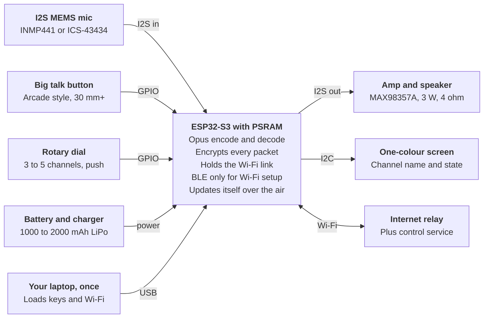

# Walkie-Talkie Beyond the R1: Minimum Hardware

Nov 14, 2026 · @Chris Barlow

## Summary

**Yes, an ESP32 can be the walkie-talkie, and it is arguably a better fit than the R1.** An ESP32-S3 encodes Opus speech at two to four times real time, encrypts it for free, holds a Wi-Fi link on 3 to 5 mA, and costs a few dollars. No reflashing, no root, no kiosk mode: the firmware is the device.

- **Minimum hardware:** ESP32-S3 with PSRAM, one I2S mic, a 3 W I2S amp and 4 ohm speaker, one big button, an optional dial, an RGB LED, a 1000 to 2000 mAh LiPo with charger. About NZ$35 to 50 a unit in parts, or NZ$25 to 30 without a battery. The relay can be hosted free.
- **Fastest route:** a from-parts build in a simple box. A LilyGO T-Embed is the ready-made match but lands at NZ$93 or more.
- **Software:** fork xiaozhi-esp32, which already does Opus over encrypted UDP on 138 boards, and point it at the same relay as the R1 design. R1s and ESP32 units can share a channel.
- **Bluetooth pairing:** workable, but only as a short-range pipe with a spoken check code on top. Plain button-only Bluetooth pairing has no protection against an attacker in the middle. For a family build, loading keys over USB at your desk is simpler and stronger; keep BLE for changing Wi-Fi later.
- **Battery:** 4 to 9 days off the dock in light sleep, against the R1's day and a half.
- **LTE:** optional. A SIM7670G board covers all NZ bands including 700 MHz, which the R1 lacks.

**Chosen spec for Grandad's unit:** rotary knob for 3 to 5 channels, a small one-colour screen, spoken channel names and one big talk button, with an optional control service for channel setup, health alerts and ringing a lost device.

What you give up against the R1: the screen and camera, a finished case, and some loudness unless you fit a bigger speaker. The relay, channel model and elder-friendly design from the [R1 doc](https://claude.ai/artifact/7Zkx68Zoz1fP9c7YDFWctL) carry over unchanged.

## Minimum requirements

The walkie needs far less than an R1. The practical floor is a dual-core 240 MHz microcontroller with Wi-Fi, a few hundred KB of spare RAM and I2S audio in and out.

| Need     | Minimum                                        | Recommended                     | Why                                                                     |
|----------|------------------------------------------------|---------------------------------|-------------------------------------------------------------------------|
| CPU      | 160 MHz single core (ESP32-C3 class, unproven) | Dual core 240 MHz (ESP32-S3)    | Opus encode takes about 25% of one core; the other runs Wi-Fi and audio |
| RAM      | About 300 KB free                              | 8 MB PSRAM                      | Opus wants 60 to 120 KB of stack plus 30 to 50 KB per codec instance    |
| Flash    | 4 MB                                           | 8 to 16 MB                      | Two firmware slots for safe over-the-air updates, plus voice prompts    |
| Mic      | One I2S MEMS mic                               | Same, or ES8311 codec           | 16 kHz mono is enough for speech                                        |
| Speaker  | 1 W class-D amp, 8 ohm                         | 3 W amp, 4 ohm, 40 mm or larger | Loudness for older ears is the weak point of pocket boards              |
| Radio    | 2.4 GHz Wi-Fi                                  | Same; LTE Cat-1 optional        | Bluetooth alone cannot reach the internet                               |
| Controls | One push-to-talk input                         | Big button plus rotary encoder  | Encoder only if there is more than one channel                          |
| Feedback | One RGB LED                                    | LED ring or small screen        | Idle, talking, listening, not connected                                 |
| Power    | USB power                                      | 1000 mAh+ LiPo, charger, dock   | See connectivity and power                                              |

Figures from the [micro-opus benchmarks](https://components.espressif.com/components/esphome/micro-opus/versions/0.4.1/readme) on ESP32-S3; the requirement statement is my inference from them.

Not needed: a camera, a touch screen, an operating system, echo cancellation (half duplex mutes the speaker while you talk), or Bluetooth after setup.

## ESP32 as the base

Yes, an ESP32 can do this, and the ESP32-S3 does it comfortably. It can keep the exact wire format from the R1 design (Opus, 20 ms frames, ChaCha20-Poly1305, TLS control), so R1s and ESP32 units could share a channel.

**Which chip.**

| Chip             | CPU              | RAM                        | Radio                           | Verdict                                                 |
|------------------|------------------|----------------------------|---------------------------------|---------------------------------------------------------|
| ESP32-S3         | 2 cores, 240 MHz | 512 KB + up to 16 MB PSRAM | Wi-Fi 2.4 GHz, BLE 5            | Use this                                                |
| ESP32 (original) | 2 cores, 240 MHz | 520 KB                     | Wi-Fi 2.4 GHz, BT Classic + BLE | Should work; no benchmark found                         |
| ESP32-C3         | 1 core, 160 MHz  | 400 KB, no PSRAM           | Wi-Fi 2.4 GHz, BLE 5            | The plausible floor; ships in voice toys, unbenchmarked |
| ESP32-C6         | 1 core, 160 MHz  | Similar to C3              | Wi-Fi 6 (2.4 GHz), BLE, Thread  | No gain over C3 here                                    |
| ESP32-C5         | 1 core, 240 MHz  | Similar                    | Dual-band Wi-Fi 6               | Only choice if 5 GHz matters                            |
| ESP32-P4         | Fast, 2 cores    | Large                      | None                            | No radio; rule out                                      |

Source: [espboards.dev chip comparison](https://www.espboards.dev/blog/esp32-soc-options/), September 2026. Modules cost roughly US$2 to 4.

**Opus load.** On an S3 at 240 MHz, fixed-point Opus encodes 16 kHz speech at 3.9 times real time at complexity 0 and 2.1 times at complexity 5, about 4 ms per 20 ms frame. Decode costs 2 to 9% of a core. The floating-point build is slower than real time, so build fixed-point ([micro-opus benchmark](https://components.espressif.com/components/esphome/micro-opus/versions/0.4.1/examples/encode_benchmark)). If Opus ever proved too heavy, G.711 costs 0.3% CPU at 64 kbit/s ([esp_audio_codec](https://components.espressif.com/components/espressif/esp_audio_codec)).

**Encryption.** Software ChaCha20-Poly1305 runs at 2 to 3 MB/s on these chips; voice is about 3 kB/s, so the cost is negligible. A TLS session needs 22 to 42 KB of heap, and TLS 1.3 and libsodium are both supported ([Oryx benchmarks](https://front.oryx-embedded.com/benchmark/espressif/crypto-esp32-c3.html), [ESP-IDF mbedTLS](https://docs.espressif.com/projects/esp-idf/en/latest/esp32/api-reference/protocols/mbedtls.html), [libsodium component](https://components.espressif.com/components/espressif/libsodium)).

**Audio parts.** An INMP441-class I2S mic and a MAX98357A amp are the standard pairing. The amp gives 3 W into 4 ohms at 5 V; set its gain pin to 15 dB, the usual fix for "too quiet" ([Adafruit](https://learn.adafruit.com/adafruit-max98357-i2s-class-d-mono-amp/pinouts?view=all), [HA forum](https://community.home-assistant.io/t/voice-assistant-volume-too-low-with-max98357a/743281)). Skip Espressif's echo-cancelling front end: it eats 820 KB and a third of a core, and half duplex does not need it ([ESP-SR](https://docs.espressif.com/projects/esp-sr/en/latest/esp32s3/benchmark/README.html)).

**What to build on.**

- [xiaozhi-esp32](https://github.com/78/xiaozhi-esp32): MIT, about 32k stars, 138 supported boards. Already does Opus over MQTT plus encrypted UDP. The best base to fork: swap its AI server for your relay and add floor control.
- [atomic14 walkie-talkie](https://github.com/atomic14/esp32-walkie-talkie): MIT. LAN only (UDP broadcast or ESP-NOW), no codec. A good read, not a base.
- [esp-webrtc-solution](https://github.com/espressif/esp-webrtc-solution): Espressif's two-way audio demo. Heavier than needed.
- No working ESP32 Mumble voice client exists, so the Mumla route from the R1 doc does not carry over.

**Latency.** No published end-to-end figures. My estimate is 120 to 200 ms with Wi-Fi power save off, on par with the R1. Power save is the catch: it delays incoming packets and is the trade against battery life.

**Remote updates.** ESP-IDF over-the-air updates use two firmware slots with automatic rollback and signed images ([OTA docs](https://docs.espressif.com/projects/esp-idf/en/latest/esp32/api-reference/system/ota.html)). That replaces the R1's Device Owner self-update, with far less ceremony.

**What you gain over the R1.** No reflash, no root, no kiosk mode: the firmware is the whole device. It boots in about a second, the button is just a GPIO pin, parts cost a tenth as much, and supply does not depend on Rabbit.

## Candidate hardware

No off-the-shelf ESP32 device has everything: one big button, a dial, a loud speaker, a battery and a case. The LilyGO T-Embed comes closest; everything else needs a part or two added.

| Device                                                                                                                                                   | What it has                                                   | NZ$ landed, incl. GST                             | NZ availability                                                                            | Verdict                                         |
|----------------------------------------------------------------------------------------------------------------------------------------------------------|---------------------------------------------------------------|----------------------------------------------------|--------------------------------------------------------------------------------------------|-------------------------------------------------|
| [LilyGO T-Embed CC1101](https://wiki.lilygo.cc/products/t-embed-series/t-embed-cc1101/)                                                                  | ESP32-S3, dial, screen, mic, speaker, 1300 mAh, case          | about 113                                          | Import ([AliExpress](https://www.aliexpress.com/w/wholesale-lilygo-t-embed-esp32-s3.html)) | Best ready-made fit, but dear. Add a big button |
| [LilyGO T-Embed](https://lilygo.cc/products/t-embed) (original)                                                                                          | ESP32-S3, dial, screen, 2 mics, 1 W speaker, case, no battery | 59 direct (sold out); about 93 on AliExpress       | Import                                                                                     | Same fit, no battery                            |
| [Home Assistant Voice PE](https://www.cnx-software.com/2024/12/20/59-voice-preview-edition-adds-an-offline-smart-speaker-to-your-home-assistant-server/) | ESP32-S3, dial, button, good speaker, case, USB only          | about 123                                          | Import                                                                                     | Plugged-in bedside unit; pricey                 |
| [M5Stack StickS3](https://shop.m5stack.com/products/m5sticks3-esp32s3-mini-iot-dev-kit)                                                                  | ESP32-S3, small screen, mic, 1 W speaker, 250 mAh, case       | about 45 direct; about 54 from Core Electronics AU | Import                                                                                     | Cheapest finished unit. No dial                 |
| [M5Stack Atom EchoS3R](https://www.digikey.co.nz/en/products/detail/m5stack-technology-co-ltd/C126-ECHO/28010869)                                        | ESP32-S3, mic, 1 W speaker, case                              | 31.49                                              | DigiKey NZ, none in stock                                                                  | Cheapest brain for a custom box                 |
| [Waveshare S3 audio board](https://www.waveshare.com/esp32-s3-audio-board.htm)                                                                           | ESP32-S3, dual mics, amp, charger; battery optional           | 33 to 37                                           | Import; Core Electronics AU about 37                                                       | Saves wiring, not money                         |
| [LilyGO T-SIM7670G-S3](https://lilygo.cc/products/t-sim-7670g-s3)                                                                                        | ESP32-S3 plus LTE, all NZ bands                               | about 75                                           | Import; sold out at LilyGO                                                                 | Only if LTE is needed                           |
| [Inrico T320](https://www.passion-radio.com/talkie-lte/t-320-1631.html)                                                                                  | Android radio, real talk button, 3500 mAh                     | EUR 205 before tax and freight                     | Import                                                                                     | Finished, but R1 money                          |
| [Raspberry Pi Zero 2 W](https://www.pbtech.co.nz/product/SEVRBP0360/Raspberry-Pi-Zero-2-W-ARM-64-bit-Cortex-A53-CPU-51)                                  | Linux board; needs audio, battery, case                       | 34.52                                              | PB Tech, none in stock                                                                     | More parts, slow boot                           |

Prices as seen on 14 November 2026, converted at NZ$1.81 to the US dollar and NZ$1.23 to the Australian dollar, with 15% GST added to US prices; shipping extra. No all-in-one board was found in NZ retail stock.

**Ruled out.** M5Dial has the right shape but only a buzzer and no mic ([Core Electronics](https://core-electronics.com.au/m5stack-dial-esp32-s3-smart-rotary-knob-with-128-touchscreen.html)). Cardputer and T-Deck have keyboards, the opposite of the brief. Pico-class boards are proven for Opus decode only ([pico-opus](https://github.com/dawidpieper/pico-opus)). nRF52 chips have no Wi-Fi.

**The T-Embed caveats.** Its only button is the small push on the dial, and a 1 W speaker may be quiet for older ears. Both are fixable: wire an arcade button to its expansion port and rehouse it with a bigger speaker. The CC1101 version also carries a sub-GHz radio, NFC and IR you will not use.

**Do you need the dial?** With only two people there is one channel. A single-button box is then the simplest device of all.

## Pairing: Bluetooth versus QR

Bluetooth can replace the QR code, but use it as a short-range pipe, not as the security. And there are two separate jobs: getting each device onto Wi-Fi, and getting the devices to trust each other.

**Why not plain Bluetooth pairing.** A device with only a button falls back to BLE's "Just Works" mode, and NIST says it plainly: "Just Works provides no MITM protection" ([NIST SP 800-121](https://nvlpubs.nist.gov/nistpubs/SpecialPublications/NIST.SP.800-121r2.pdf)). The authenticated modes need a display or keypad on both ends. So the pattern is: open a BLE (or ESP-NOW) link between two units side by side, exchange keys over it, then confirm with a short check both units speak or blink.

**Also note:** the ESP32-S3 has BLE only, no Bluetooth Classic, and Bluetooth cannot carry the voice between two houses. It is a setup tool only. The BLE stack costs about 110 KB of RAM while running, nearly all reclaimable once setup ends ([ESP-IDF provisioning](https://docs.espressif.com/projects/esp-idf/en/stable/esp32s3/api-reference/provisioning/provisioning.html)).

**Job 1: Wi-Fi onto a screenless device.**

| Method                                                                                                                                   | How it works                                                                            | Verdict                                             |
|------------------------------------------------------------------------------------------------------------------------------------------|-----------------------------------------------------------------------------------------|-----------------------------------------------------|
| [Espressif BLE provisioning](https://docs.espressif.com/projects/esp-idf/en/stable/esp32s3/api-reference/provisioning/provisioning.html) | Stock phone app sends Wi-Fi details over encrypted BLE, unlocked by a code on a sticker | Best for changes in the field                       |
| USB at build time ([Improv Serial](https://www.improv-wifi.com/))                                                                        | You load both homes' Wi-Fi from a laptop before handing it over                         | Simplest for a family build                         |
| [Improv over BLE](https://www.improv-wifi.com/ble/)                                                                                      | Open standard, button press to authorise                                                | No encryption of its own; browser flow fails on iOS |
| SoftAP captive portal                                                                                                                    | Device becomes a hotspot with a setup page                                              | Works, clunky; unstable alongside BLE               |
| [Wi-Fi Easy Connect](https://docs.espressif.com/projects/esp-idf/en/stable/esp32/api-reference/network/esp_dpp.html)                     | QR-based standard                                                                       | Needs a display on the device                       |
| [SmartConfig](https://docs.espressif.com/projects/esp-idf/en/stable/esp32/api-reference/network/esp_smartconfig.html)                    | Phone app broadcasts details                                                            | Still needs an app; no advantage                    |

**Job 2: devices trusting each other.**

| Method                                                                                                                                      | Needs                              | Security                                          | Verdict                                         |
|---------------------------------------------------------------------------------------------------------------------------------------------|------------------------------------|---------------------------------------------------|-------------------------------------------------|
| Keys loaded at build time                                                                                                                   | Laptop, USB                        | Strong; nothing sent over the air                 | Simplest. Recommended for v1                    |
| "Hold both buttons" over BLE or [ESP-NOW](https://docs.espressif.com/projects/esp-idf/en/stable/esp32s3/api-reference/network/esp_now.html) | Units side by side, speaker or LED | Strong if you confirm a spoken 3 to 4 digit check | Nicest later, for adding units without a laptop |
| Server claim code                                                                                                                           | Web admin page on the relay        | Strong; relay becomes trusted for membership      | Good for remote changes                         |
| QR code                                                                                                                                     | Camera or screen                   | Strong                                            | The R1 way; ESP32 boards lack a camera          |
| Plain BLE pairing                                                                                                                           | Nothing                            | Weak (Just Works)                                 | Avoid                                           |

For scale, consumer products mostly dodge device-to-device pairing and bind devices to an account instead; Meshtastic shares a channel key by QR or link ([Amazon FFS](https://developer.amazon.com/docs/frustration-free-setup/understanding-ffs.html), [Meshtastic](https://meshtastic.org/docs/software/android/user/messages-and-channels/)).

**Recommended flow.**

1.  At your desk, a laptop script gives each unit its own key pair, the group key, the relay address and both homes' Wi-Fi over USB.
2.  Hand one over. It joins Wi-Fi and the channel on its own.
3.  If Wi-Fi changes later, hold the button 10 seconds to open BLE provisioning; use the phone app and the sticker code. BLE stays off otherwise.
4.  Because each unit has its own key pair, the relay can re-key the group, add a third unit or drop a lost one without anyone touching the devices.

Bluetooth "hold both buttons" pairing is a good second release. It adds firmware and a failure mode Grandad never needs to meet.

## Connectivity and power

An ESP32 on Wi-Fi can outlast the R1 by days, because it can doze between router beacons and still be reachable. Start Wi-Fi only; LTE roughly doubles the cost and adds a SIM.

**Standby on Wi-Fi.** Espressif's own figures for a connected ESP32-S3 in automatic light sleep are 2.45 mA when waking for every beacon (DTIM 1) and 1.33 mA at every third. Without light sleep it sits at 10 to 40 mA ([ESP-IDF low-power Wi-Fi](https://docs.espressif.com/projects/esp-idf/en/v5.5/esp32s3/api-guides/low-power-mode/low-power-mode-wifi.html)). These are vendor lab numbers; plan on 3 to 5 mA. The price is latency on the first packet of a message: roughly 100 ms at DTIM 1 and 300 ms at DTIM 3 (my estimate). Pre-roll buffering hides it, and once a message starts the radio stays awake.

**Battery life** (my arithmetic: 80% usable capacity, 20 minutes of talk a day at about 180 mA):

| Standby draw | Mode                                   | 1000 mAh | 2000 mAh  |
|--------------|----------------------------------------|----------|-----------|
| 22 mA        | Radio always awake, lowest latency     | 1.4 days | 2.7 days  |
| 5 mA         | Light sleep, planning figure           | 4.4 days | 8.9 days  |
| 3 mA         | Light sleep, vendor figure plus margin | 6.1 days | 12.1 days |

The R1 manages about 36 hours on its 1000 mAh, around 28 mA. So: on the dock, run the radio fully awake for the fastest response; off the dock, drop to light sleep. A 1000 to 2000 mAh cell is plenty.

**Amp.** Drive the MAX98357A's shutdown pin. It idles at 2.4 mA but 0.6 uA when shut down, and wakes in 7 ms. On a bare LiPo it gives about 0.9 W into 8 ohms; feed it 5 V and a 4 ohm speaker for the full 3 W ([datasheet](https://www.analog.com/media/en/technical-documentation/data-sheets/max98357a-max98357b.pdf)).

**Charging.** A charger with power path, such as the [BQ24074](https://www.ti.com/product/BQ24074), runs the device from USB while charging the cell, which suits something that lives on a dock. Use a protected cell.

**LTE, if a home has no Wi-Fi.**

- Use LTE Cat-1 or Cat-1 bis with Bands 28 and 3. The SIM7670G covers every NZ band, which fixes the R1's missing 700 MHz ([LilyGO](https://lilygo.cc/products/t-sim-7670g-s3)).
- Cat-M1 can carry the voice in good coverage but is marginal; NB-IoT cannot, with latency of 1.6 to 7.6 seconds ([Hologram](https://www.hologram.io/blog/nb-iot-vs-cat-m1-vs-cat-1/)).
- 3G is gone in NZ: 2degrees from December 2025, One NZ and Spark by March 2026 ([RNZ](https://www.rnz.co.nz/news/business/581864/the-3g-shutdown-in-nz-is-starting-here-s-what-you-need-to-know)). Data-only voice does not care.
- The modem sleeps at 0.7 mA but transmits at 550 to 690 mA ([SIM7672X manual](https://files.waveshare.com/wiki/ESP32-S3-SIM7670G-4G/SIM7672X_Series_Hardware_Design_V1.01.pdf)). With keepalives, expect 10 to 15 mA standby (my estimate) and a bigger battery.
- SIMs: usage is about 110 to 200 MB a month. Skinny at $8 per 4 weeks (250 MB) or Warehouse Mobile at $9 (300 MB) fit, about $104 to $120 a year ([Canstar](https://www.canstar.co.nz/mobile-phone/cheapest-mobile-phone-plans/), 2 Nov 2026). 1NCE covers NZ but its 500 MB over 10 years would need constant top-ups.

**NZ radio rules.** RSM's supplier regime (declaration, RCM label) applies to products supplied to the market ([RSM](https://rsm.govt.nz/business-individuals/supplier-compliance/steps)). A one-off family build is not supply, on my reading, but should use a certified module and stay within the short-range device licence ([RSM SRD licence](https://www.rsm.govt.nz/licensing/frequencies-for-anyone/short-range-devices-gurl)). Espressif publishes an RSM declaration for the ESP32-C3-MINI-1 ([DoC](https://documentation.espressif.com/ESP32-C3-MINI-1%20RSM%20DoC.pdf)); I could not confirm one for the S3 module. Selling these would need the full process.

## Recommended build

Build from parts around an ESP32-S3 with a rotary knob, a small screen and spoken channel names, in a simple box. A LilyGO T-Embed is the ready-made match (knob, screen, mic, speaker, case) but lands in NZ at two to three times the cost of parts.

**Grandad's unit, as specified.**

- **Knob:** 3 to 5 channels. It stops at each end, so fully left is always channel one.
- **Screen:** a small one-colour OLED, 0.96 to 1.3 inches. Channel name in large text, and one big word for the state: TALK, LISTEN, WAIT, OFFLINE. A status LED beside it adds the colour.
- **Spoken names:** each click says the channel name. Clips are recorded once (ideally in each person's own voice) and pushed from the control service.
- **Big button:** hold to talk. Nothing else to press.
- **Knob press:** replays the last message. Text entry by knob (turn for a letter, press to accept) exists only behind a long press as a setup fallback, and can be switched off on his unit.

*A whole walkie is one ESP32-S3 and six cheap parts.*

Everything on the left and top right lives in the case; the relay is the same one the R1 design uses, and the laptop is only needed once at setup.

**Bill of materials** (NZ dollars including GST, excluding shipping; AliExpress search prices as of 14 November 2026, not checkout quotes):

| Part                                        | Imported, NZ$ incl. GST | In NZ stock                                                                                                                                                                                                    |
|---------------------------------------------|--------------------------|----------------------------------------------------------------------------------------------------------------------------------------------------------------------------------------------------------------|
| ESP32-S3 dev board, 16 MB flash, 8 MB PSRAM | about 10                 | None found. [DigiKey NZ](https://www.digikey.co.nz/en/products/detail/m5stack-technology-co-ltd/C126-ECHO/28010869) lists the M5Stack Atom EchoS3R at $31.49 and an S3 dev board at $32.58, neither in stock |
| I2S mic breakout (INMP441)                  | 2 to 4                   | None. [Core Electronics AU](https://core-electronics.com.au/i2s-microphone-inmp441.html) about $15                                                                                                            |
| MAX98357A 3 W amp breakout                  | 2 to 4                   | None. [Little Bird AU](https://littlebirdelectronics.com.au/products/adafruit-i2s-3w-class-d-amplifier-breakout-max98357a) or Core about $13                                                                  |
| 4 ohm 3 W speaker, 40 to 50 mm              | 1.50                     | Surplustronics $8.90                                                                                                                                                                                          |
| Big push button, 30 mm+                     | 2 to 4                   | Surplustronics $2.50                                                                                                                                                                                          |
| Rotary encoder with knob                    | 2 to 3                   | Surplustronics $4.50; [Jaycar](https://www.jaycar.co.nz/arduino-compatible-rotary-encoder-module/p/XC3736) $12.90                                                                                            |
| Small one-colour OLED, 0.96 to 1.3 inch     | about 2                  | Surplustronics $7.50                                                                                                                                                                                          |
| LiPo 1000 mAh                               | 2 to 8                   | None. Jaycar 18650 cell $21.90 plus $1.60 holder                                                                                                                                                             |
| USB-C charger board                         | 0.50                     | Surplustronics $1.60 (Micro USB)                                                                                                                                                                              |
| Case                                        | about 5                  | Surplustronics ABS box $5.50                                                                                                                                                                                  |
| **Total per unit**                          | **about 35 to 50**       | Core parts must be imported                                                                                                                                                                                    |

A [Waveshare S3 audio board](https://core-electronics.com.au/waveshare-esp32-s3-smart-speaker.html) at about NZ$35 landed replaces the first three lines and the charger. LiPo cells are awkward to air-freight; buy those locally.

**Build plan.**

1.  **Breadboard night.** A T-Embed, or an S3 dev board with mic, amp, speaker, screen, knob and button. Flash xiaozhi-esp32 unmodified to prove the audio chain and loudness.
2.  **Firmware.** Fork it: replace the AI server link with the walkie relay protocol, add floor control, chirp and busy tones, the knob, screen states and spoken channel names.
3.  **Setup tooling.** Laptop script that writes keys, relay address and Wi-Fi over USB. Long-press to open BLE provisioning.
4.  **Control service.** Admin page for channels, names and device health, then ring and re-key.
5.  **Power.** Light sleep off the dock, radio awake on it. Measure real standby current.
6.  **Case and trial.** Print the case, fit the dock, then a week with Grandad as in the R1 plan.

## Cost in NZ dollars, and keeping it low

A unit costs about NZ$35 to 50 in parts with a battery, and about NZ$25 to 30 without. The relay can be free. So two walkies come to roughly NZ$55 to 100 all up, plus shipping. Prices include 15% GST and use NZ$1.81 to the US dollar ([x-rates](https://www.x-rates.com/table/?from=NZD&amount=1), 13 Nov 2026).

**Where to buy.** The three core parts (ESP32-S3 with PSRAM, I2S mic, I2S amp) are not stocked by any NZ retailer I could check, so they are an import either way. The simple parts are in NZ stock at [Surplustronics](https://surplustronics.co.nz/search?q=esp32) in Auckland, at a premium over AliExpress. Jaycar is dearer again. PB Tech, Trade Me and Nicegear blocked automated checks, so look there by hand.

**What cuts the cost most.**

1.  **Build from parts, not a kit.** A T-Embed lands at NZ$93 to 113 from AliExpress, two to three times the parts cost. No kit found was cheaper than parts.
2.  **Host the relay for nothing.** Oracle's Always Free tier gives a small server with a public address for NZ$0 ([Oracle](https://docs.oracle.com/en-us/iaas/Content/FreeTier/resourceref.htm)). Oracle can reclaim idle machines, so the fallback is a Vultr server at NZ$4.50 to 9 a month ([Vultr](https://www.vultr.com/pricing/)). Hosting at home is free only if your connection already has a public address; 2degrees charges NZ$10 a month for a static one ([2degrees](https://www.2degrees.nz/help/broadband-help/ip-addresses/2degrees-ip-addresses)).
3.  **One AliExpress order, multi-packs.** Chargers come in fives, speakers in pairs, encoders in fives. GST is charged at checkout and nothing more is due at the border under NZ$1,000 ([IRD](https://www.ird.govt.nz/gst/gst-for-overseas-businesses/gst-on-low-value-imported-goods)).
4.  **Skip the battery on Grandad's unit** if it lives on its dock. Saves NZ$3 to 11 and the lithium shipping question. Add one later if he wants to carry it.
5.  **Use a small OLED with built-in knob** instead of the colour screen and separate encoder: about NZ$2 for both, against NZ$10. Decided: one colour is fine, so every unit uses this.
6.  **Case.** A Surplustronics ABS box is NZ$5.50. Kapiti libraries 3D print at 10 cents a gram, about NZ$4 to 6 a case ([Kapiti Coast](https://www.kapiticoast.govt.nz/libraries/services-at-our-libraries/3d-printing/)); I found no Hutt City equivalent.

**Lean unit, about NZ$25 to 30:** S3 board 10, mic 3, amp 3, speaker 1.50, OLED with knob 2, button 2.50, box 5.50, USB powered.

**Caveats.** AliExpress prices were read from search pages in US dollars, not NZ checkout, and many NZ$2 prices look like first-order deals. Shipping to NZ was not shown. The S3 board, button and box import prices are from memory. Treat the totals as a good guess until there is a real basket.

## Optional control service

The relay already knows every device, so a small admin layer beside it can manage the fleet: channels, settings, health and a lost-device alarm. It is optional by design: devices cache their last settings, so talking still works if the control service is down. This section is a design proposal, not sourced research.

| Function              | What it does                                                                                                                                                |
|-----------------------|-------------------------------------------------------------------------------------------------------------------------------------------------------------|
| Channels              | Create, rename and order channels (order sets the knob position), choose which units are on each, record or upload the spoken name                          |
| Device settings       | Volume, treble boost, quiet hours, knob lock, hold or tap to talk, text entry on or off. Pushed live, no visit needed                                       |
| Health                | Battery, charging, online, last seen, Wi-Fi signal, firmware version. Alerts the caregiver's phone on low battery or offline                                |
| Ring a lost device    | The unit sounds a loud alarm at full volume and flashes its screen until the button is pressed. If it is offline, the ring is queued for when it reconnects |
| Where was it          | Last-seen time and the Wi-Fi network it was on. No GPS on the Wi-Fi build; an LTE build with a SIM7670G modem could add a satellite fix                     |
| Lost for good         | Revoke the unit's key and re-key every channel remotely, so it can no longer listen                                                                         |
| Add or replace a unit | Enrol a new unit by its sticker code and assign channels; it picks up names and keys on first connect                                                       |
| Updates               | Roll firmware out to one unit first, then the rest; automatic rollback on failure                                                                           |

**How it fits.** Each unit already holds a TLS control connection to the relay. The control service adds a few commands on that link (settings, ring, re-key, update) and a web admin page behind a login, on the same small server. It can be the same Go program with a SQLite file.

**Keeping it from being a weak point.** A central service that manages membership and firmware is a tempting target, so limit what it can do:

- It never holds channel keys. The admin page creates each key in your browser and wraps it for each unit's own public key; the server only stores and forwards the wrapped copies.
- Firmware is signed with a key kept off the server, so a compromised server cannot push its own code.
- There is no remote listen, ever. The ring is loud and obvious on purpose.
- Health and last-seen data are visible to whoever runs the page, so tell Grandad what it shows.

## Risks and open questions

| Risk                                | Impact                     | Mitigation                                                               |
|-------------------------------------|----------------------------|--------------------------------------------------------------------------|
| Speaker too quiet for older ears    | He cannot hear it          | 3 W amp at 5 V, 4 ohm 40 mm+ speaker in a sealed box; test before casing |
| Light sleep delays first packet     | Clipped or late start      | Pre-roll buffer; radio fully awake on the dock                           |
| Standby figures are vendor lab data | Shorter battery life       | Measure with a power profiler; plan on 5 mA                              |
| No published ESP32 PTT latency      | Unknown until built        | Prototype on a dev board first                                           |
| T-Embed stock and price unclear     | Delay                      | From-parts build needs only commodity parts                              |
| ESP32-C3 encode unproven            | Cheapest chip may not cope | Use the S3                                                               |
| LiPo left on charge for years       | Cell wear, safety          | Protected cell, power-path charger, consider charging to 4.1 V           |
| xiaozhi fork diverges from upstream | Maintenance                | Keep changes in the protocol layer only                                  |
| Still not an alarm                  | Unsafe reliance            | Same as the R1 doc: printed card, pair with a monitored alarm            |

**Unconfirmed:** current T-Embed prices and AliExpress availability, real AliExpress checkout prices and shipping to NZ, an RSM declaration for the S3 module, Spark and 2degrees NB-IoT status, and whether NZ 3G shutdowns finished on schedule. Bill of materials prices are estimates, not quotes.

## Sources

- ESP32 capability: [micro-opus readme](https://components.espressif.com/components/esphome/micro-opus/versions/0.4.1/readme) · [encode benchmark](https://components.espressif.com/components/esphome/micro-opus/versions/0.4.1/examples/encode_benchmark) · [esp_audio_codec](https://components.espressif.com/components/espressif/esp_audio_codec) · [chip comparison](https://www.espboards.dev/blog/esp32-soc-options/) · [Oryx crypto benchmarks](https://front.oryx-embedded.com/benchmark/espressif/crypto-esp32-c3.html) · [ESP-IDF OTA](https://docs.espressif.com/projects/esp-idf/en/latest/esp32/api-reference/system/ota.html)
- Projects: [xiaozhi-esp32](https://github.com/78/xiaozhi-esp32) · [its UDP protocol](https://github.com/78/xiaozhi-esp32/blob/main/docs/mqtt-udp.md) · [atomic14 walkie-talkie](https://github.com/atomic14/esp32-walkie-talkie) · [esp-webrtc-solution](https://github.com/espressif/esp-webrtc-solution)
- Hardware: [LilyGO T-Embed](https://lilygo.cc/products/t-embed) · [T-Embed CC1101](https://wiki.lilygo.cc/products/t-embed-series/t-embed-cc1101/) · [T-SIM7670G-S3](https://lilygo.cc/products/t-sim-7670g-s3) · [M5Stack StickS3](https://www.cnx-software.com/2026/01/23/m5stack-sticks3-esp32-s3-mini-iot-dev-kit-features-1-14-inch-color-display-speaker-and-mic-for-voice-interaction/) · [Voice PE](https://www.cnx-software.com/2024/12/20/59-voice-preview-edition-adds-an-offline-smart-speaker-to-your-home-assistant-server/) · [Waveshare S3 speaker board](https://core-electronics.com.au/waveshare-esp32-s3-smart-speaker.html) · [Inrico T320](https://www.passion-radio.com/talkie-lte/t-320-1631.html) · [MAX98357A datasheet](https://www.analog.com/media/en/technical-documentation/data-sheets/max98357a-max98357b.pdf)
- Pairing: [NIST SP 800-121](https://nvlpubs.nist.gov/nistpubs/SpecialPublications/NIST.SP.800-121r2.pdf) · [ESP-IDF provisioning](https://docs.espressif.com/projects/esp-idf/en/stable/esp32s3/api-reference/provisioning/provisioning.html) · [Improv Wi-Fi](https://www.improv-wifi.com/) · [ESP-NOW](https://docs.espressif.com/projects/esp-idf/en/stable/esp32s3/api-reference/network/esp_now.html) · [RF coexistence](https://docs.espressif.com/projects/esp-idf/en/stable/esp32s3/api-guides/coexist.html)
- Power and LTE: [ESP-IDF low-power Wi-Fi](https://docs.espressif.com/projects/esp-idf/en/v5.5/esp32s3/api-guides/low-power-mode/low-power-mode-wifi.html) · [ESP32-S3 datasheet](https://documentation.espressif.com/esp32-s3_datasheet_en.pdf) · [SIM7672X manual](https://files.waveshare.com/wiki/ESP32-S3-SIM7670G-4G/SIM7672X_Series_Hardware_Design_V1.01.pdf) · [One NZ IoT networks](https://one.nz/iot/networks) · [Canstar plans](https://www.canstar.co.nz/mobile-phone/cheapest-mobile-phone-plans/) · [RSM supplier steps](https://rsm.govt.nz/business-individuals/supplier-compliance/steps)

<!-- -->

- NZ prices and hosting: [Surplustronics](https://surplustronics.co.nz/search?q=esp32) · [Jaycar NZ](https://www.jaycar.co.nz/esp32-main-board-with-wifi-and-bluetooth-communication/p/XC3800) · [DigiKey NZ](https://www.digikey.co.nz/en/products/detail/m5stack-technology-co-ltd/C126-ECHO/28010869) · [Core Electronics](https://core-electronics.com.au/development-boards/esp32.html) · [AliExpress parts search](https://www.aliexpress.com/w/wholesale-inmp441-max98357a.html) · [IRD on GST for imports](https://www.ird.govt.nz/gst/gst-for-overseas-businesses/gst-on-low-value-imported-goods) · [Customs NZ](https://www.customs.govt.nz/personal/duty-and-gst/) · [Oracle free tier](https://docs.oracle.com/en-us/iaas/Content/FreeTier/resourceref.htm) · [Vultr](https://www.vultr.com/pricing/) · [exchange rates](https://www.x-rates.com/table/?from=NZD&amount=1)
